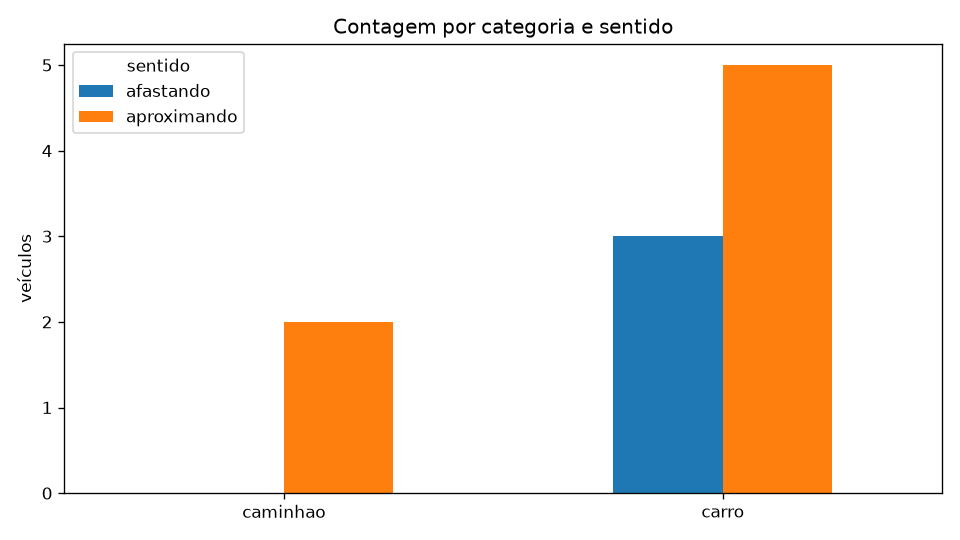
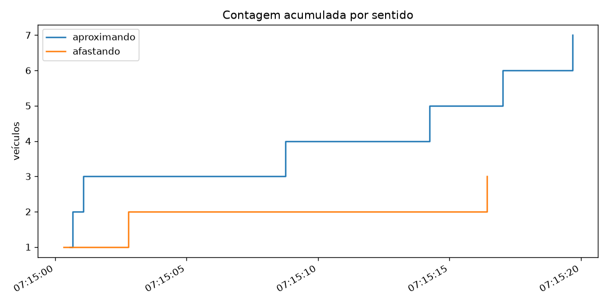
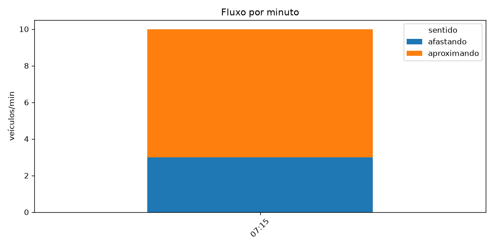

# Relatório de contagem veicular

- Fonte: `amostras/rodovia.mp4`
- Início: 2026-10-30 07:15:00  |  Duração: 0.4 min
- Total contado: **10** veículos (1672.9 veíc/h)
- Duplicatas suprimidas (troca de identidade): 0
- Categorias corrigidas pela votação ao longo da trilha: 0

## Recomendações de ação

1. Volume observado: 10 veículos em 0.4 min (taxa equivalente de 1673 veíc/h).
2. Fluxo equivalente: aproximando 77% (1673 UCP/h) x afastando 23% (502 UCP/h). Sugestão: repartir o tempo de verde útil na proporção 77/23 entre as aproximações.
3. Fluxo desbalanceado no sentido aproximando: avaliar onda verde nesse sentido e, se o padrão se repetir em outros dias, faixa reversível no horário.
4. Veículos pesados são 20% do tráfego: considerar janela de carga e descarga fora do pico, fiscalização de peso e manutenção preventiva do pavimento.
5. Nenhum fluxo anormal detectado: manter a programação semafórica atual e seguir monitorando.

## Contagem por categoria e sentido

| categoria | afastando | aproximando | total |
|---|---|---|---|
| caminhao | 0 | 2 | 2 |
| carro | 3 | 5 | 8 |
| total | 3 | 7 | 10 |

## Contagem por faixa horária (60 min)

| faixa_inicio | faixa_fim | observado_min | sentido | carro | moto | onibus | caminhao | van | bicicleta | outro | total | ucp | veic_h | ucp_h |
|---|---|---|---|---|---|---|---|---|---|---|---|---|---|---|
| 2026-10-30 07:00 | 08:00 | 0.36 | aproximando | 5 | 0 | 0 | 2 | 0 | 0 | 0 | 7 | 10.0 | 1171.0 | 1672.9 |
| 2026-10-30 07:00 | 08:00 | 0.36 | afastando | 3 | 0 | 0 | 0 | 0 | 0 | 0 | 3 | 3.0 | 501.9 | 501.9 |

## Alertas de fluxo anormal

_sem dados_

## Gráficos

